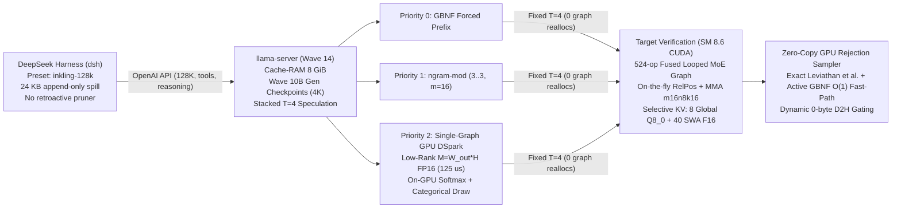

# Inkling-2-Mini — Custom SM 8.6 CUDA Engine & 128K Agentic Stack (RTX 3090)

[English](README.md) | [Español](README.es.md)

[-76b900?logo=nvidia&logoColor=white)](docs/BENCHMARKS.md)
[-blue)](docs/ARCHITECTURE.md)
[](docs/BENCHMARKS.md)
[-success)](docs/BENCHMARKS.md#accuracy--statistical-verification)
[](deploy/systemd/nvidia-power-cap.service)

> **From `55.5 t/s @ 32K` to `131–165 t/s` real-world multi-turn agentic coding, `114–125 t/s` at 118K context, and `96.7 %` sustained KV cache hit (0 BPE rollbacks across 107-step / 29-image sessions) on a single consumer RTX 3090 (24 GB, 265 W) — with zero quantization degradation and exact Leviathan et al. probabilistic speculative decoding.**

This repository contains **~20,600 lines of custom Ampere SM 8.6 CUDA kernels and C++ inference-engine engineering (Waves 1–14)** built on top of [`unslothai/llama.cpp`](https://github.com/unslothai/llama.cpp) (pull request #390 @ `8aa2f23`), alongside a full production 128K agentic coding stack (`inkling-proxy.mjs`, `fast-mcp.mjs`, $O(1)$ Jinja template) for **[thinkingmachines/Inkling-2-Mini](https://huggingface.co/thinkingmachines/Inkling-2-Mini)** (`UD-Q4_K_XL`, looped-transformer + 128-expert NVFP4 MoE + hybrid SWA/global attention + DSpark speculative drafter + vision projector).

---

## Test Hardware & Environment Disclosure

All benchmarks in this repository (both the **stock baseline** and **Waves 1–14**) were measured on the same machine:
- **GPU**: Gigabyte NVIDIA GeForce RTX 3090 (24 GB GDDR6X, Ampere SM 8.6), power-capped to **280 W** in Waves 8–12 and **265 W (`-lgc 210,1800`)** from Wave 13 onward (`nvidia-power-cap.service`, holding `75–77 °C` sustained).
- **Driver / OS**: Linux `x86_64`, NVIDIA Open Kernel Module `595.99.02`.
- **Tensor Core Unlock**: **[Zagitta/gpu-unlock](https://github.com/Zagitta/gpu-unlock) v2.0.0** active at boot (`gpu_unlock.targets=0000:09:00.0`, `SS0=0x88888888`, `SS1=0x8` — full-rate `FP16/BF16/TF32` Tensor Cores with `FP32` accumulation).
  - **What changes if you benchmark *without* `gpu-unlock`**: `T=1` decode and `NVFP4`/`Q8_0` `dp4a` MoE kernels are memory-bandwidth-bound and remain virtually identical. However, **long-context prompt prefill (`pp512`, 32K–128K)** and our **Wave 9B `mma.sync.m16n8k16` (`FP16→FP32`) Split-K Flash Attention kernel** (`T=2..8` at 64K–128K) directly use `FP16→FP32` Tensor Cores and will measure lower absolute throughput without `gpu-unlock`. Relative speedups over the stock baseline remain comparable since both baseline and optimized builds were tested under the same configuration.

---

## Executive Results (RTX 3090 24 GB)

| Metric | Stock Baseline (`bin/` / `pr390`) | **Final (Wave 10, 280 W Cap)** | Gain |
| :--- | ---: | ---: | ---: |
| Raw 1-token decode (`llama-bench tg256`, `d=0`) | `55.5 – 59.1 t/s` *(370 W)* | **`122.0 – 125.6 t/s`** *(280 W; `134.3` @ 370 W)* | **2.2× – 2.4×** |
| Prompt prefill (`llama-bench pp512`, `d=0`) | `1,264 – 1,477 t/s` *(370 W)* | **`2,345 t/s`** *(280 W; `2,656` @ 370 W)* | **1.8× – 2.1×** |
| CUDA graph kernel launches per decode token | `~5,000+` *(11,508 ggml nodes)* | **`524 ops/tok`** | **~10× fewer launches** |
| Max context in 24 GB VRAM (+ DSpark + GPU Vision) | `32K` (`~21.3 GiB`) | **`128K (131,072)`** (`22.8` idle / `23.3 GiB` peak, ~1.25–1.75 GiB free) | **4× context** |
| Vision encoding (`1440×810` PNG / `960×540` JPEG) | `5,835 ms` / `2,229 ms` *(CPU)* | **`785 ms`** / **`356 ms`** *(GPU `VISION_OFFLOAD=1`)* | **7.4× / 6.3× (16.4× vs PNG CPU)** |
| Speculative verification `T = 5` (`llama-bench -d 512`) | `26.20 ms/step` *(Wave 7)* | **`16.47 ms/step`** *(303.7 t/s)* | **-37.1 % (1.59×)** |
| Long-ctx `T = 5` attention @ `d = 128K` (Tensor Core MMA) | `~130 t/s` *(pre-MMA)* | **`180.0 t/s`** *(+38 %, `pp8 = 197.1 t/s`)* | **+38 – 40 %** |
| DSpark `n=4` greedy (`temp=0.0` refactor, 100 % exact) | `~74 – 82 t/s` | **`194.0 t/s`** *(32K)* | **2.37×** |
| DSpark `n=4` probabilistic (`temp=1.0`, exact Leviathan) | `0.50 t/s` *(broken)* | **`135–143 t/s`** *(32–64K w/ tools)* · **`125 t/s`** *(118K)* | **>250×** |
| High-entropy creative reasoning (`temp=1.0`, Wave 10C) | `91.6 – 97.3 t/s` *(cool)* · `78–85` *(warm)* | **`109.8 t/s`** *(EMA adaptive `T=5↔T=1`, 0 % code regression)* | **+13 % – +30 %** |
| Live multi-turn `deepseek exec` (`fast-mcp` + GPU vision) | `~48–60 s` per visual check (`agent-browser`) | **`10.99 s` total** *(5-turn edit+Chrome+GPU vision, `114–180 t/s`)* | **~30–50× faster checks** |
| Long-session KV resilience (105K pruner / 1-tok BPE drift) | `77.1 s` freeze / full re-prefill | **`0 ms` pruner** + **`92.7 %` KV rescued** *(SWA-1K + post-image ckpts)* | **Eliminated stalls** |
| Accuracy vs unmodified `pr390` F16 ref (`inkcheck`) | Reference noise floor: `96.5 %` top-1 | **`96.0–100.0 %` top-1**, KLD `1.25e-3 – 5.41e-3`, `|z| ≤ 1.47` | **0 % loss** |

---

## System Architecture



---

## 14-Wave Engineering Evolution

| Wave | Core Engineering Breakthrough | Before → After (Verified on RTX 3090) |
| :--- | :--- | :--- |
| **Baseline** | Stock Unsloth `b12588` & native `pr390` (`tools/ref`) | `55.5 – 59.1 t/s` `tg128`, `1,264 – 1,477 t/s` `pp512`, `32K` max ctx |
| **Waves 1–5** | Branchless 5-inst `UE4M3→FP32` NVFP4, nosync 8-warp GEMV, fused `control()` (W3), `shortconv4`, `mix()`, `SiTU`, `l2_clip+SET_ROWS`, router Top-8 | `55.5–59.1 → 98.0–99.4 t/s` (**+79 %**); `pp512 → 2,580.5 t/s` (**+104 %**) |
| **Wave 6 (6A–6D)** | Horizontal Q+Gate+R+K+V+Sink GEMV, `cp.async` NVFP4 MoE + SiTU, `down+reduce`, `sigmoid·mul+wo`, triple `control()`, Q/R clip pair + **fixed GPU `--backend-sampling`** (`4,000/4,000` GPU==CPU) | `99.4 → 129.8 t/s` `tg256` (370 W); `816 ops/tok`; `chat.sh` `107.3 → 119.2 t/s` |
| **Wave 7 (A1/A2, 7A–7C)** | Inline producer `Q8_1` (`48/48`), full 3-kernel MoE pipeline, custom 1-token GQA=3 `cp.async.cg` RelPos Flash Attention, `GET_ROWS` fold, `need_probs` D2H skip | `816 → 524 ops/tok` (**-292 launches**); `tg256 → 134.3 t/s` (**2.27×**); reasoning `126–129 t/s` |
| **Wave 8 (8.1–8.4)** | Zero-spill expert-grouped `T=2..8` MoE & attention fusions, rollback `shortconv4`, precomputed DSpark low-rank head `M=W_out·H` (`595→125 µs`), multi-block `argmax` (`40→5 µs`), `O(1)` `prob_of()`, **280 W cap** | `T=5` `26.20 → 16.47 ms` (**-37.1 %**); DSpark greedy `82 → 194.0 t/s` (**2.37×**); prob `0.50 → 129.9 t/s` (**260×**) |
| **Wave 9 (9A–9D)** | On-the-fly RelPos in Flash Attention (**-15 GiB** tables → **128K**), selective KV `Q8_0` (8 global) + `F16` (40 SWA), **SM 8.6 Tensor Core `mma.sync.m16n8k16` Split-K**, hybrid GPU grammar sampling, stacked `T=5` spec + CPU vision | `32K → 128K` in `22.2 GiB`; `pp5@128K` **+38 % (`180 t/s`)**; JSON/Tools **+41 % / +32 %**; 120K real coding **`91.5–104.2 t/s`** |
| **Wave 10 (10A–10D + GPU Vision + `fast-mcp`)** | **Single-graph GPU probabilistic DSpark**, exact Leviathan GPU rejection sampling **with `tools`/`json_schema`/`reasoning_budget`**, **Wave 10B/10D** 4K SWA-1K gen & post-image checkpoints, **Wave 10C** EMA adaptive `T=5↔T=1` gate, **GPU Vision (`VISION_OFFLOAD=1`)**, persistent **`fast-mcp.mjs`** (`browser`/`view_image`/`multi_edit`) | `32K/64K` w/ tools **`135–143 t/s` (+37–54 %)**; creative reasoning **`97.3 → 109.8 t/s` (+13–30 %)**; vision **6.3–7.9× (`356–785 ms`)**; visual check **`10–16 s → 0.21–0.48 s`**; live 5-turn E2E **`10.99 s`** (`114–180 t/s`) |
| **Wave 11 (Zero-D2H Spec + Split-K Prefill)** | **Device-resident GPU Leviathan rejection sampling** (`0 B` `q_probs` PCIe D2H, `16 B` result), **fused DSpark softmax + `draft_min_p` + exact CDF sample**, dual tiny scheduler for DSpark inject graphs, **Path 2B/3 SM 8.6 Tensor-Core Split-K prefill FA** (`T=9..256`), `n-4` tail checkpoint batching | Eliminates `q_probs` D2H stalls & triple-split tool prefills; faster short-to-medium agentic prefills |
| **Wave 12 (CPU-Loop Hygiene + Rate Gate)** | **Measured-rate adaptive spec gate** (`cycle` vs `plain`), **GBNF grammar & vocab token memoization**, sampler reserve skip, **single-thread decode loop (`THREADS=1`)** eliminating idle spin-wait cores | Lower host CPU overhead; tighter adaptive `T=5↔T=1` switching with 0 % code regression |
| **Wave 13 + Production Agentic Stack** | **256-byte LUT `base64_decode` + zero-copy `data:` URI**, **lossless incremental prefix + generated-token + 48-entry image-chunk LRU cache** with on-demand rollback hydration, `wave10d` `2048`-tok min-gap, $O(1)$ Jinja template, **`inkling-proxy.mjs`** (compaction KV-hit + `budget=0`, `bash_high_effort`, `low_cap_escalate`, `loop_rescue`), **`fast-mcp.mjs` v2** (`read_batch`, lossless PNG, cache-disabled reload, reversible `rAF` pause + 10-min auto-close, `mobile: true` 390×844), **`265 W`** cap | Live 107-step / 29-image session: **`96.67 %` KV hit**, **`102/102` `f_keep=1.000` (0 BPE rollbacks)**, 4 compactions **`94.9–97.6 %` KV hit (`10.9 s` total vs `736 s`)**, `preCPU` **`164.2 → 22.9 s`**, idle Chrome **`1,071 % → 0.2 %` CPU**, **`0` swap growth**, **`75–77 °C`** |
| **Wave 14 (Correctness, Determinism & Draft Length)** | **Shared-memory race fixed in both batched `mma.sync` attention kernels** (the tail of `s_VT[w]` overlapped the head of `s_K[w+1]`), which made batched decode non-deterministic; DSpark low-rank head in true FP32 (the cuBLAS handle was in TF32 mode); ~20 latent fixes (per-context kernel state, `W6_NO_KVFUSE` path, deferred logits, graph reuse, sampler signature, GBNF memo, generation checkpoints without speculation); **`$ORIGIN` RPATH** (each binary folder loads its own libraries); **dedicated scheduler for the plain 1-token step** (`sched_t1`); **3-token drafts by default** (`T=4`) | `inkcheck --decode-batch 5`: **`17/93` deviating runs → `0/112`**; server at `temp 0` with speculation always on: **`7` and `5` distinct outputs in 8 runs → `1` and `1`**; 1-token decode bit-identical to Wave 13; plain step **`-1.1 %`**, chained short turns **`-1.7 %`**; draft length 3 vs 4: **`+3.3 %` new code, `+3.0 %` reasoning, `+4.7 %` tool calls, `-4.1 %` time on chained short turns, `-4.0 %` verbatim rewrite**; `tools/validate.sh`: KLD `5.29e-3` (noise floor `4.03e-3`), top-1 `98.44 %`, `z = -0.52` |

Full technical breakdown → [docs/ARCHITECTURE.md](docs/ARCHITECTURE.md) · Complete benchmark tables & accuracy proofs → [docs/BENCHMARKS.md](docs/BENCHMARKS.md)

---

## Repository Contents

```text
├── patches/
│   ├── inkling2-sm86-wave14.patch   # Complete git-apply patch (~20,600 lines over unslothai/llama.cpp@8aa2f23)
│   └── apply-and-build.sh           # Reproducible SM 8.6 CUDA build script
├── kernels/
│   └── inkling-fused.cuh            # Standalone browsable copy of the custom SM 8.6 CUDA kernels (Waves 1–14)
├── templates/
│   └── chat-template-inkling-o1.jinja # Byte-exact O(1) dict chat template (eliminates O(M^2) tool_call_id scan)
├── docs/
│   ├── ARCHITECTURE.md              # Kernel design, math proofs, and KV-cache systems postmortems (Waves 1–14)
│   └── BENCHMARKS.md                # Full Wave 1–14 measurements, live audits (Run 1→3), and accuracy checks
├── scripts/                         # Production launcher (128K Wave 14), CLI chat, GPU thermal monitor & power cap
├── deploy/                          # systemd units (inkling-server, inkling-proxy, 265W power cap) and env file
├── configs/deepseek-harness/        # 128K local agent preset (inkling-128k), inkling-proxy.mjs, fast-mcp.mjs
└── tools/                           # inkcheck.cpp (KLD/NLL verifier), gen/turn/AB benches, smoke tests, microbenches, export-patch.sh
```

---

## Quickstart (Reproduce on RTX 3090 / Ampere SM 8.6)

### 1. Build the custom SM 8.6 binaries
```bash
./patches/apply-and-build.sh
```
This fetches [`unslothai/llama.cpp`](https://github.com/unslothai/llama.cpp) at base commit `8aa2f23` (head of its pull request #390), applies [patches/inkling2-sm86-wave14.patch](patches/inkling2-sm86-wave14.patch), and compiles `llama-server`, `llama-cli`, `llama-bench`, `llama-perplexity`, and `llama-completion` for `SM 8.6` into `bin-sm86/`. The script never resets a source tree that carries other local changes; to rebuild from scratch give it a fresh `SRC_DIR`.

### 2. Download weights into `models/`
- `Inkling-2-Mini-UD-Q4_K_XL.gguf` (16.41 GiB)
- `dspark-Inkling-2-Mini-Q8_0.gguf` (384 MiB)
- `mmproj-F16.gguf` (610 MiB, offloaded to GPU at 128K via `VISION_OFFLOAD=1` for 6.3–7.9× faster vision encoding; set `VISION_OFFLOAD=0` for CPU fallback)

### 3. Apply thermal cap & launch the 128K Wave 14 server (+ adaptive proxy)
```bash
sudo ./scripts/gpu-power-cap.sh 265
./scripts/start-server.sh
# Optional: run the byte-preserving adaptive budget & compaction KV-hit proxy (:8081 -> :8080)
./configs/deepseek-harness/tools/inkling-proxy.mjs
```

### 4. Verify endpoints & precision
```bash
python3 tools/server-smoke.py 8080          # Chat, Vision, JSON Schema, Tool Call, Logprobs (5/5 OK)
./tools/build-tools.sh && ./tools/validate.sh  # Teacher-forcing KLD / top-1 / paired-NLL vs stock reference
```

The launcher defaults to 3-token drafts (`DSPARK_N=3 NGRAM_MIN=3 NGRAM_MAX=3`); set the three to 4 for workloads that mostly copy text verbatim. For reproducible outputs at `temp 0` run it with `W10_NO_ADAPT_SPEC=1` (the adaptive gate decides from measured timings).

> **Reproducing exact prefill & long-context MMA numbers**: All benchmarks here were run with **[Zagitta/gpu-unlock](https://github.com/Zagitta/gpu-unlock) v2.0.0** active (`SS0=0x88888888`, `SS1=0x8`). Without it, `T=1` decode is nearly unchanged, while long-context prefill and Wave 9B `mma.sync.m16n8k16` (`FP16→FP32`) attention at 64K–128K will run at GeForce's stock half-rate Tensor Core speed.

## License

MIT License — matching upstream [`llama.cpp`](https://github.com/ggml-org/llama.cpp). See [LICENSE](LICENSE).
